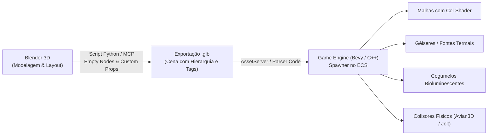
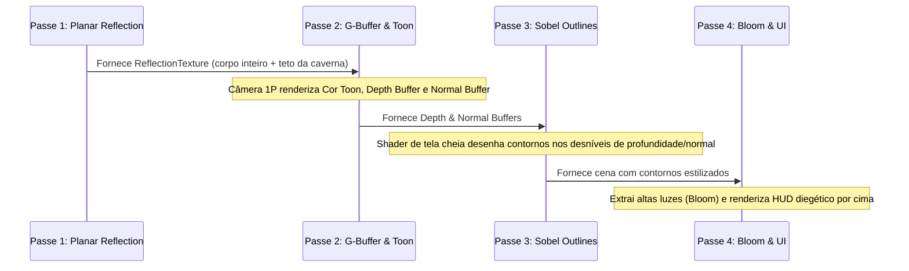

# Code-First Game Development (Rust Bevy & C++20 Modular)

Esta skill estabelece os princípios de arquitetura, padrões de engenharia e referências para construir jogos desktop de alto desempenho e imersão (estilo *Skyrim* / RPG de exploração em 1ª pessoa) através de um paradigma **100% Code-First** — sem editores visuais pesados ou arquivos de cena binários opacos.

O desenvolvimento Code-First é o padrão ouro para programação assistida por Agentes de IA, pois todo o projeto (cenas, lógica, física, materiais e shaders) consiste em arquivos de texto puro e declarativo (`.rs`, `.cpp`, `.wgsl`, `.json`, `.ron`), permitindo controle total, compilação estrita e testes automatizados.

---

## 🏛️ 1. O Ecossistema Rust: Bevy (0.15+) & Avian3D

### 1.1 Arquitetura ECS (Entity Component System)
No Bevy, o jogo é estruturado em torno do ECS:
- **Entities:** IDs numéricos simples que representam objetos no mundo.
- **Components:** Estruturas de dados puras (sem lógica interna) anexadas a entidades (ex.: `Position`, `Velocity`, `Health`, `ItemInstance`).
- **Systems:** Funções Rust puras que iteram sobre entidades com determinados componentes através de `Query`.
- **Resources:** Dados globais únicos (ex.: `AssetServer`, `Time`, `GameState`, `Input`).
- **Plugins:** Módulos que agrupam recursos, eventos e sistemas para um subsistema específico (ex.: `PlayerPlugin`, `DungeonPlugin`, `AlchemyPlugin`).

### 1.2 Configuração Recomendada de Dependências (`Cargo.toml`)
Para garantir máxima velocidade de compilação em desenvolvimento no Windows e suporte a shaders e física:

```toml
[package]
name = "deep_alchemy"
version = "0.1.0"
edition = "2024"

[dependencies]
bevy = { version = "0.15", default-features = true, features = ["dynamic_linking"] }
avian3d = "0.2" # Física 3D nativa e ergonômica baseada no ECS do Bevy
serde = { version = "1.0", features = ["derive"] }
ron = "0.8" # Formato de dados Rusty para receitas de poções e dados de itens

# Otimizações de compilação para Rust GameDev
[profile.dev]
opt-level = 1

[profile.dev.package."*"]
opt-level = 3
```

> [!TIP]
> A feature `dynamic_linking` no Bevy reduz o tempo de recompilação incremental de 15s para menos de 1.5s durante a iteração de código.

### 1.3 True First-Person (Full-Body Awareness)
Diferente de shooters com braços flutuantes, em True First-Person o Alquimista possui malha e esqueleto completos instanciados:
- **Câmera:** Anexada ao osso da cabeça/olhos (`Camera3dBundle`), com controle de *Yaw* no corpo e *Pitch* na câmera.
- **Render Layers:**
  - O corpo principal (pernas, tronco, braços, mochila) fica na Layer padrão (`Layer 0`).
  - A cabeça e o chapéu fedora são configurados com `ShadowsOnly` para a câmera principal (evitando clipping no FOV), mas visíveis para a câmera de reflexo planar e reflexões no espelho d'água.
- **Transição de Morte e Ragdoll (`avian3d`):**
  1. Ao atingir `Health <= 0`, o sistema desativa o `KinematicCharacterController`.
  2. Altera a malha da cabeça/chapéu para visibilidade total (Layer 0).
  3. Adiciona componentes `RigidBody::Dynamic` aos ossos do ragdoll aplicando força do último impacto.
  4. Desacopla a câmera da cabeça, ativando uma câmera orbital/terceira pessoa suave focando o corpo tombando no chão da caverna.

---

## ⚙️ 2. O Ecossistema C++20 Modular

Se a escolha for C++20 puro com compilação direta via CMake:

| Camada | Biblioteca Padrão | Justificativa Técnica |
| :--- | :--- | :--- |
| **Janela & Contexto Gráfico** | **SDL3** ou **Raylib** | Gerenciamento de janelas multiplataforma, eventos de mouse pointer lock e contexto gráfico limpo. |
| **Renderizador** | **bgfx** ou **DirectX 12 / Vulkan** | Abstração gráfica moderna com controle de múltiplos framebuffers e passes de renderização. |
| **Arquitetura (ECS)** | **EnTT** | A biblioteca ECS mais performática do mundo em C++ (utilizada em jogos AAA e Minecraft). |
| **Física & Ragdoll** | **Jolt Physics** | Criada pela Guerrilla Games (*Horizon Forbidden West*), excelente documentação de ragdolls e colisores compostos. |
| **Importador de Malhas 3D** | **cgltf** ou **Assimp** | Parser rápido de arquivos `.gltf` / `.glb` contendo esqueleto, pesagem de vértices (*skinning*) e animações. |
| **Áudio 3D** | **miniaudio** | Single-header sem dependências, com atenuação espacial de cachoeiras e passos. |
| **Serialização** | **nlohmann/json** | Parsing de tabelas de alquimia e dados de saves. |

---

## 🎨 3. Level Design Sem Editor: O Fluxo Blender $\rightarrow$ glTF 2.0

Para construir cavernas densas com iluminação e pontos de interação sem IDE de engine:



### 3.1 Convenção de Nomes e Tags no Blender
Ao modelar ou posicionar objetos no Blender:
- `M_Rock_LOD0`: Malha de renderização com Toon Shader.
- `COL_Rock_Convex`: Prefixo reconhecido pelo importador de código para gerar um colisor físico convexo (`Collider::convex_hull`).
- `Spawn_Mushroom_Cyan`: Nó vazio (*Empty*) com custom properties:
  ```json
  {
    "type": "mushroom_cyan",
    "light_color": [0.0, 0.95, 1.0],
    "light_intensity": 3.0,
    "harvestable_id": "ingredient_glow_spore"
  }
  ```
- `Zone_Water_Lake`: Plano com propriedade `{"is_water": true, "reflection_plane": true}`.

---

## 🖼️ 4. Pipeline Gráfico de 4 Passes (Cel-Shading + Água Reflexiva)

Para atingir a qualidade das artes conceituais do projeto (iluminação anime/cartoon rica com reflexos em tempo real da caverna e do alquimista):



### 4.1 Shader WGSL de Água Reflexiva com Espuma nas Bordas
No Bevy, o shader de água amostra a textura de reflexo e a profundidade da cena:

```wgsl
struct WaterMaterial {
    color: vec4<f32>,
    foam_color: vec4<f32>,
    foam_threshold: f32,
};

@fragment
fn fragment(
    in: VertexOutput,
    @builtin(position) frag_coord: vec4<f32>,
) -> @location(0) vec4<f32> {
    // 1. Calcula a profundidade da água comparando a profundidade do fundo da caverna
    let scene_depth = sample_scene_depth(frag_coord.xy);
    let water_depth = frag_coord.z;
    let depth_diff = scene_depth - water_depth;

    // 2. Espuma estilizada desenhada onde a água toca rochas ou a praia
    var final_color = material.color;
    if (depth_diff < material.foam_threshold) {
        final_color = mix(material.color, material.foam_color, smoothstep(0.0, material.foam_threshold, depth_diff));
    }

    // 3. Composição com reflexo planar da caverna e do Alquimista
    let screen_uv = frag_coord.xy / view.viewport.zw;
    let reflection = textureSample(reflection_texture, reflection_sampler, screen_uv);
    final_color = mix(final_color, reflection, 0.4);

    return final_color;
}
```

---

## 📚 5. Documentação & Guias de Pesquisa Rápida

Quando pesquisar APIs, sintaxes ou resolver dúvidas de integração, consulte:

- **Bevy Engine:**
  - Site Oficial & Livro: `https://bevyengine.org/learn/book/introduction/`
  - Bevy Cheat Book (Guia Completo): `https://bevy-cheatbook.github.io/`
  - Exemplos Oficiais no GitHub: `https://github.com/bevyengine/bevy/tree/main/examples`
  - Termos para busca: `Bevy 0.15 CustomMaterial`, `Bevy WGSL Prepass Depth Normal`, `Bevy RenderLayers`
- **Avian3D (Física Rust):**
  - Repositório & Docs: `https://github.com/Jondolf/avian` / `https://docs.rs/avian3d`
  - Termos para busca: `avian3d KinematicCharacterController`, `avian3d Ragdoll RevoluteJoint`, `avian3d RayCaster`
- **Jolt Physics (C++):**
  - Repositório Oficial: `https://github.com/jrouwe/JoltPhysics`
  - Samples: `JoltPhysics/Samples` (Ragdoll, CharacterVirtual)
- **glTF 2.0 & Blender Export:**
  - Especificação glTF 2.0: `https://registry.khronos.org/glTF/specs/2.0/glTF-2.0.html`
  - Blender Python API (`bpy`): `https://docs.blender.org/api/current/`
